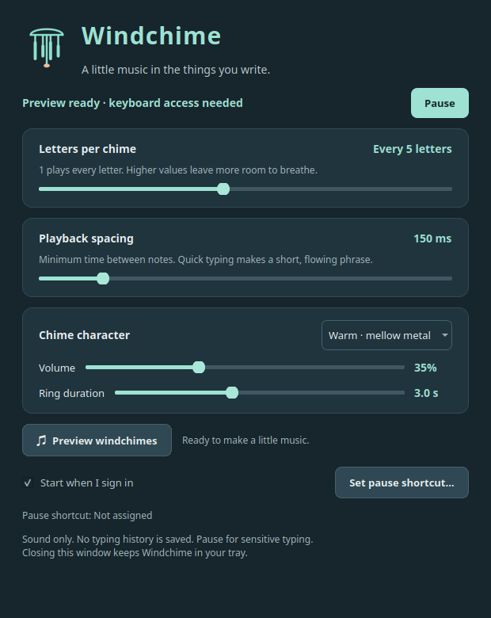

# Windchime

Windchime is a native Linux tray app that turns typing into gentle windchime notes. Adjust how many letters trigger a note, space the notes out, and let their tails overlap while you work.



## Features

- Play a note every 1–10 letters, with 40–800 ms minimum spacing.
- Choose Warm, Airy, or Bright chimes, 0–100% volume, and 1–6 seconds of ringing.
- Pause from the tray or a configurable global shortcut, suggested as Ctrl+Alt+W.
- Keep running when the window closes and optionally start at sign-in.
- Preview the sound without enabling global keyboard access.

The sound uses an original synthesized pentatonic palette, stereo variation, up to 12 overlapping voices, and a soft limiter. Playback queues at most four notes and discards notes older than half a second. Windchime does not record a composition for later replay.

## Desktop support

Tested on **Ubuntu 25.10 x86-64 with KDE Plasma 6.4.5, Wayland, and PipeWire**. The supplied binary targets that environment and uses the system Qt 6.9 libraries. Build from source for other distributions or older Qt/glibc versions.

Global listening requires systemd-logind, a local active graphical session on seat0, and readable physical keyboard devices through the installed helper. A desktop tray host and the FreeDesktop ScreenSaver service are required for background listening. Global shortcuts use the desktop portal and depend on desktop support. Other desktops are not yet validated.

## Privacy and keyboard access

The tray app runs as your normal user. A separate root-owned helper opens physical keyboard devices read-only, maps triggering keys directly to note numbers, and sends those numbers through a Unix socket restricted to your user. It never assembles words, forwards text, saves keyboard history, grabs the keyboard, or injects input. The app makes no network requests.

The helper closes its readers when paused, when the app disconnects or stops sending its heartbeat, or when the local desktop session becomes inactive or locked. If logind communication fails, it exits so systemd can restart it safely. Your user is not added to the input group, and device permissions are not loosened.

**A global keyboard reader cannot reliably recognize password fields. Pause Windchime before sensitive typing in an unlocked session.** Screen locking also stops listening, but there is no claim of password-field detection.

Only physical A–Z key positions count. Spaces, digits, punctuation, shortcuts, and held-key repeats are silent. Editing and navigation reset the letter counter. Pasted text, dictation, and IME-composed text are not captured; pitches follow physical key positions across layouts.

## Install the release

Download the Ubuntu 25.10 x86-64 archive and `SHA256SUMS` from [Releases](https://github.com/brenden-eshbach/windchime/releases). Verify the archive against its checksum, extract it, and run:

```sh
cd windchime
./install.sh
```

Linux asks for administrator authentication to install the keyboard helper and launcher. The app opens afterward. On a compatible Ubuntu system, the runtime dependencies are Qt 6 Core, GUI, Widgets, Network and DBus, libpulse, libsystemd, and the Qt Wayland platform plugin.

Open **Windchime** from your application launcher. Closing its window keeps it in the tray; right-click the icon for Pause, Preview, or Quit. Middle-click toggles listening. Use **Set pause shortcut** to configure the shortcut through KDE.

The installer writes the app to `/opt/windchime`, a launcher and icon under `/usr/share`, and its socket/service units under `/etc/systemd/system`. Settings are stored in `~/.config/Windchime/Windchime.conf`; optional startup uses `~/.config/autostart/windchime.desktop`.

## Build from source

On Ubuntu with Qt 6 development packages:

```sh
sudo apt install build-essential qt6-base-dev qt6-base-dev-tools libpulse-dev libsystemd-dev
./build.sh
./install.sh
```

The build requires C++20 and Linux headers. `CXX`, `MOC`, and `WINDCHIME_SYSROOT` can override compiler, Qt meta-object compiler, or header root. Generated files stay under `build/`. No browser runtime, downloaded sound bank, or embedded web app is required.

## Run the checks

```sh
./run-tests.sh
```

The checks cover settings parsing, letter density, shortcut filtering, editing, queue limits, finite audio, overlapping voices, decay, mute, native sliders, saved settings, preview cancellation on lock, and close-to-tray behavior. Core tests also run under AddressSanitizer and UndefinedBehaviorSanitizer.

On an unprivileged Linux session with a system bus, the helper protocol check additionally exercises socket activation, a paused default, single-client access, invalid messages, heartbeat expiry, and reconnects. It refuses to run if the test user can read physical input devices. It never needs administrator access. Diagnostic UI checks do not connect to the keyboard helper. Physical hotplug and an actual desktop lock/unlock cycle remain manual desktop checks.

## Commands

```sh
/opt/windchime/windchime --show
/opt/windchime/windchime --pause
/opt/windchime/windchime --resume
/opt/windchime/windchime --preview
/opt/windchime/windchime --shortcut
/opt/windchime/windchime --status
/opt/windchime/windchime --quit
```

Control commands target the running app. Normal launches use a per-user lock to prevent duplicate instances. Preview is also available from the window and tray menu.

## Uninstall

Run as your normal desktop user:

```sh
/opt/windchime/uninstall.sh
```

The uninstaller closes the app, asks for administrator authentication, and removes the system files, helper, startup entry, and settings. It leaves any downloaded archive or source checkout intact.

## Credits

Inspired by [Typatone](https://typatone.com/). This project's code, icon, and synthesized chimes are original; it contains no Typatone sound assets.
